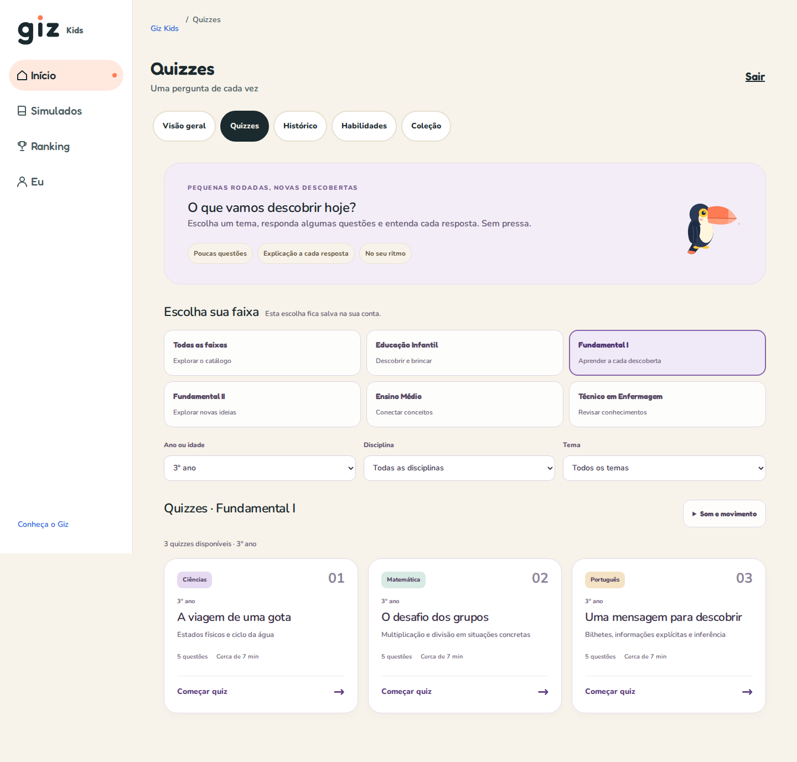

# Catálogo de quizzes — investigação de 21/10/2026

Relato e acompanhamento: [issue #90](https://github.com/guilhermeborba/simulados-bernardo/issues/90). A captura do responsável mostra a área **Quizzes**, com **Fundamental I / 3º ano**, todas as disciplinas e todos os temas, exibindo o estado vazio.

## Catálogo e publicação

Quizzes e simulados usam catálogos distintos:

| Área | Consulta | Conteúdo |
|---|---|---|
| Quizzes da Prática | `GET /quizzes/available?schoolYear=3` | Quizzes curtos publicados e autorizados para o 3º ano |
| Simulados | `GET /simulations/available` | Simulados completos, com filtros próprios de ano, disciplina, bimestre e avaliação |

O filtro da captura envia o ano 3 para a API e conserva somente a faixa Fundamental I na lista recebida. A API retorna quizzes `PUBLISHED`, ativos e autorizados. Rascunhos e conteúdo arquivado não aparecem para o aluno.

O catálogo versionado na API tem **45 quizzes / 213 perguntas aprovadas**, com três quizzes por cada um dos 15 públicos. Para o 3º ano são **três quizzes / 15 perguntas**. A aprovação está registrada em [aprovação e voz Dora](https://github.com/guilhermeborba/simulados-bernardo-api/blob/main/docs/aprovacao-quizzes-e-voz-dora.md).

O comando `npm run seed` importa os simulados. Quizzes têm um importador separado: `npm run seed:quizzes` cria rascunhos por padrão. A publicação do catálogo aprovado exige `npm run seed:quizzes:publish-reviewed`. Mergear conteúdo ou publicar a aplicação não executa essa operação.

O estado vazio da captura é compatível com quizzes ausentes ou ainda em rascunho no ambiente consultado. **O banco e a sessão de produção não foram acessados; a hipótese de falta de publicação depende de conferência pelo responsável.**

## Procedimento para o responsável

No console do serviço **da API** no Railway, no ambiente que atende ao site, conferir primeiro o catálogo do checkout implantado, sem gravar dados:

```bash
npm run seed:quizzes:dry-run
```

O resultado esperado para este catálogo é 45 quizzes, 213 perguntas, 15 públicos, 45 aprovados e zero pendentes; o ano 3 deve indicar três quizzes e 15 perguntas.

Antes de publicar, o responsável pode conferir somente as contagens/status de quizzes do 3º ano no ambiente atendido por esse console, sem ler perguntas ou dados de alunos:

```bash
node <<'NODE'
const { PrismaClient } = require('@prisma/client');
const db = new PrismaClient();
db.simulation.groupBy({
  by: ['status'],
  where: { activityKind: 'QUIZ', schoolYear: 3, deletedAt: null },
  _count: { _all: true },
}).then(rows => console.table(rows.map(row => ({ status: row.status, total: row._count._all }))))
  .catch(() => { console.error('Falha ao consultar os status.'); process.exitCode = 1; })
  .finally(() => db.$disconnect());
NODE
```

Um resultado sem linhas indica que não há registros de quizzes do 3º ano nesse filtro; linhas `DRAFT` indicam rascunhos. Se já houver quizzes `PUBLISHED` e a tela continuar vazia, conferir a resposta do endpoint, disciplinas ativas e autorização de turma, sem repetir a publicação como correção presumida.

Para importar/publicar o catálogo aprovado, usar o e-mail de um **ADMIN ativo que já exista nesse ambiente**:

```bash
QUIZ_SEED_AUTHOR_EMAIL='email-do-admin-ativo' npm run seed:quizzes:publish-reviewed
```

Substituir o e-mail ilustrativo pelo administrador real. O autor inativo criado pelo seed legado não atende ao requisito. As disciplinas também precisam existir e estar ativas. O importador valida referências, conteúdo e aprovação antes de gravar; rascunhos idênticos podem ser publicados, e versões arquivadas/excluídas não são reativadas. Não contornar erros editando status diretamente no banco.

Depois, recarregar **Quizzes**, selecionar Fundamental I / 3º ano e conferir os três cartões e a contagem. O catálogo de Simulados deve continuar disponível pelo menu lateral. Se a tela ainda ficar vazia após uma publicação bem-sucedida, registrar o status e a quantidade retornada por `/api/backend/quizzes/available?schoolYear=3` na aba Rede do navegador, sem copiar cookies ou tokens, para continuar o diagnóstico.

O procedimento é uma operação explícita do responsável. Não foi executado em banco existente ou produção nesta investigação. Publicar quizzes não publica automaticamente missões ou habilidades pendentes.

## Validação local

- `npm run seed:quizzes:dry-run`: 45 quizzes / 213 perguntas, 15 públicos, todos aprovados; três quizzes / 15 perguntas no 3º ano.
- API: `npm run prisma:generate` e `npm run build` aprovados com fontes equivalentes à `main` após api#239.
- Web: `npm run typecheck && npm run lint && npm test && npm run build` aprovados, com 62 testes.

A reprodução usou os arquivos reais do checkout, PostgreSQL novo criado pelo runner de prévia, API em loopback e web local. O aluno da prévia estava vinculado à turma local Bernardo; os 65 simulados incluem os conteúdos autorizados para esse vínculo e não são uma promessa de contagem para outra conta.

| Consulta/estado | Importação padrão | Após publicação explícita |
|---|---:|---:|
| Quizzes publicados no catálogo inteiro | 0 | 45 |
| Quizzes do 3º ano | 0 | 3 |
| Simulados do 3º ano autorizados ao aluno da prévia | 65 | 65 |

Playwright reproduziu a seleção Fundamental I / 3º ano em desktop e celular: antes da publicação mostrou o mesmo estado vazio da captura; depois exibiu **A viagem de uma gota**, **O desafio dos grupos** e **Uma mensagem para descobrir**. A API confirmou três quizzes em cada um dos 15 públicos. A repetição do importador preservou os 45 IDs/versões e publicou zero registros adicionais.



A imagem é da validação local com banco descartável. Não demonstra que o catálogo tenha sido publicado no ambiente real e não encerra o aceite visual da E13.

O PostgreSQL, a API, a web e as credenciais temporárias foram removidos/encerrados pelo runner ao fim; a ausência do container e das portas locais foi conferida. Nenhum banco existente foi usado. O fluxo padrão pode ser conferido com `npm run preview:mobile:catalog -- --check`; o modo publicado, com `npm run preview:mobile:catalog -- --check --publish-reviewed`, conforme o [guia da prévia](https://github.com/guilhermeborba/simulados-bernardo-api/blob/main/docs/preview-mobile-catalogo-e-voz.md).

**Resultado:** não foi reproduzido defeito de filtro para a seleção da captura com quizzes publicados. A falta de importação/publicação explica esse mesmo estado no ambiente descartável. Resta ao responsável conferir o estado no ambiente publicado e executar a ativação quando necessária; se os quizzes já estiverem publicados, o próximo diagnóstico deve usar a resposta do endpoint e as referências ativas desse ambiente.
